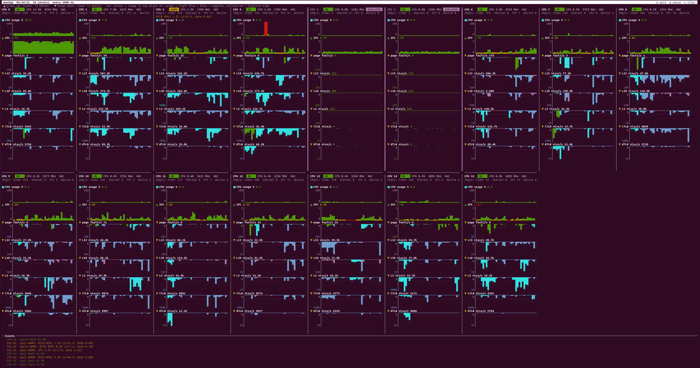

# pmutop

**A top-like, per-core view of CPU hardware performance counters, for finding what limits a core.**

pmutop reads each core's PMU (performance monitoring unit) through the Linux `perf_event_open()` interface and shows, live and per core:

- CPU usage measured by the hardware, and the average clock while awake
- IPC (instructions per cycle)
- L1 instruction, L1 data and L2 cache misses
- instruction and data TLB misses
- page faults, and interrupts by source

From these you can usually tell whether a core is limited by memory, by instruction fetch, by address translation, by its clock, or by interrupts. pmutop also learns each core's normal level and warns when a core departs from it.

Cores isolated from the Linux scheduler (`isolcpus`), as used for real-time work such as **Xenomai 4 / EVL**, get extra support. Their usage figure includes out-of-band threads that Linux cannot see, they get stricter alarm rules, and a real-time task can report its own frame timing to pmutop.



*`pmutop` with no options on a 16-core Intel Core Ultra 9 285H: every chart, cores 0-11 on page 1 of 2 (←/→ to switch). CPU 4 and 5 are isolated real-time cores (magenta `ISOLATED` tag and dividers). CPU 8 and 9 are in WARN for a jump in dTLB misses per 1000 instructions; the event log at the bottom lists the state changes.*

## Contents

1. [Installation](#installation)
2. [Supported CPUs](#supported-cpus)
3. [Quick start](#quick-start)
4. [Options](#options)
5. [The graphic view](#the-graphic-view)
6. [Text and CSV output](#text-and-csv-output)
7. [How pmutop measures](#how-pmutop-measures)
8. [Hardware events](#hardware-events)
9. [Warnings](#warnings)
10. [Real-time and Xenomai support](#real-time-and-xenomai-support)
11. [Reading the numbers: common bottlenecks](#reading-the-numbers-common-bottlenecks)
12. [Requirements and limitations](#requirements-and-limitations)
13. [Troubleshooting and FAQ](#troubleshooting-and-faq)
14. [Validation](#validation)
15. [Source layout](#source-layout)

## Installation

pmutop is a single C program with no dependencies beyond the C library and libm: no ncurses, no libperf, no perf tool.

```
git clone <this repository> pmutop
cd pmutop
make                # needs a C compiler (gcc or clang) and make
make check          # optional unit test
```

**Requirements**

- Linux with `perf_event_open()`. Tested on 6.18; any recent kernel should do.
- A CPU with a hardware PMU that the kernel exposes. Most virtual machines, including WSL2, do not expose one; see the [FAQ](#troubleshooting-and-faq).
- A UTF-8 terminal for the full-screen view.

### Running without root

Counting every core needs privileges. The options, from most to least contained:

| Option | Command | Notes |
|---|---|---|
| Run with sudo | `sudo ./pmutop` | Simplest |
| Give the binary `CAP_PERFMON` (Linux 5.8+) | `sudo setcap cap_perfmon+ep ./pmutop` | Then run `./pmutop` as a normal user. Tested. File capabilities are ignored on `nosuid` mounts such as `/tmp`, so keep the binary elsewhere |
| Lower the system-wide restriction | `sudo sysctl kernel.perf_event_paranoid=0` | Lets **every** user count CPU-wide and see other users' activity. Not recommended on shared machines. Lasts until reboot |

Without any of these, pmutop can only follow your own threads (`-p`), counting user space only.

## Supported CPUs

| CPU | Works out of the box | Needs event codes |
|---|---|---|
| Intel Core Ultra 200H (Arrow Lake H, family 6 model 197): P-, E- and LP E-cores | everything; tested | — |
| Other Intel and AMD x86 CPUs | CPU usage\*, clock\*, IPC, last-level-cache misses, iTLB/dTLB misses, page faults, interrupts | L1I, L1D, L2 charts |
| ARM64 | IPC, cache and TLB events where the PMU maps them, page faults, interrupts | L1I, L1D, L2; not tested |

\* CPU usage and clock use the reference-cycle event. Where a PMU lacks it (not tested, but AMD may), pmutop falls back to Linux's `/proc/stat` usage and the cpufreq clock.

Only the Core Ultra 200H has been tested. Charts without an event show `-` or stay empty; everything else keeps working.

### Adding event codes for your CPU

L1I, L1D and L2 misses need model-specific codes, one per core type. To find them:

1. **List the PMUs.** `ls /sys/bus/event_source/devices/`. Non-hybrid x86 CPUs have one, `cpu`; Intel hybrids have `cpu_core`, `cpu_atom` and sometimes `cpu_lowpower`.
2. **Find the events.** `perf list --details` lists them with their encoding. Good candidates on Intel are `mem_load_retired.l1_miss` (L1D), `l2_rqsts.demand_data_rd_miss` (L2) and `frontend_retired.l1i_miss` (L1I); E-cores use `mem_load_uops_retired.*` and `frontend_retired.icache`. For example:

   ```
   $ perf list --details | grep -A2 "l2_rqsts.demand_data_rd_miss$"
     l2_rqsts.demand_data_rd_miss
          [Demand Data Read miss L2 cache. Unit: cpu_core]
           cpu_core/event=0x24,period=200003,umask=0x21/
   ```

3. **Turn the fields into a code.** The bit positions are in `/sys/bus/event_source/devices/<pmu>/format/`. On Intel, `event` is `config:0-7` and `umask` is `config:8-15`, so `event=0x24,umask=0x21` gives `0x2124`. A field that lives in `config1` goes in the third part of the spec. On P-cores, for example, `frontend` is `config1:0-23`, so `frontend_retired.l1i_miss` (`event=0xc6,umask=0x3,frontend=0x12`) becomes `cpu_core:0x03c6:0x12`. Ignore `period`; it only matters for sampling.
4. **Pass them to pmutop**, one `PMU:config[:config1]` per core type:

   ```
   sudo ./pmutop --l2-event cpu_core:0x2124,cpu_atom:0x80d1
   ```

5. **Check them** against perf on a busy core. Run `perf stat -e <pmu>/<event-name>/,<pmu>/instructions/ -C 3 -- sleep 5` next to `sudo ./pmutop -b -c 3`, and compare misses per 1000 instructions.

If you add codes for another CPU, please contribute them so they can be built in.

## Quick start

```
make
sudo ./pmutop                         # every core, every chart, full-screen
sudo ./pmutop -c 0-3 -s cpu,ipc,l2    # cores 0-3, three charts
sudo ./pmutop -c isolated             # only the cores isolated with isolcpus=
sudo ./pmutop -b -n 10 -o run.csv     # 10 text samples, also recorded to CSV
sudo ./pmutop -p <tid>                # follow one thread instead of cores
make check                            # unit test
```

With no options, pmutop watches every online core and shows every chart in the full-screen view. When its output is not a terminal (piped or redirected), it prints text lines instead.

Run pmutop on a core you are not watching closely, for example `sudo taskset -c 0 ./pmutop ...`, so that it does not add load to the cores it measures.

## Options

```
What to watch:
  -c, --cpus=LIST        cores: all, isolated, or a list such as 0,2,4-7
                         (default: all)
  -p, --pid=TID          follow one thread instead of cores

How to show it:
  -g, --graphic          full-screen charts (default on a terminal)
  -b, --batch            one text line per core per sample
  -s, --show=LIST        charts in the full-screen view, in this order
                         (default: all): cpu,ipc,pf,l1i,l1d,l2,itlb,dtlb,frame
  -i, --interval=MS      sampling interval in milliseconds (default 1000)
  -n, --count=N          stop after N samples (default: until q or Ctrl-C)
  -o, --csv=FILE         also write every sample to FILE

Real-time tasks:
  -t, --telemetry=FILE   frame timing published by a real-time task

Hardware events (raw code per core type: PMU:CONFIG[:CONFIG1][,...];
built in for Intel Core Ultra 200H):
      --l1i-event=SPEC   L1 instruction-cache misses
      --l1d-event=SPEC   L1 data-cache misses
      --l2-event=SPEC    L2 cache misses

  -h, --help             show this help
  -V, --version          show the version
```

Notes:

- `--cpus` and `--pid` are mutually exclusive, as are `--graphic` and `--batch`. Offline or unknown CPUs are rejected rather than shown as empty panels.
- `--interval` accepts 10 ms to 1 hour.
- `--graphic` given explicitly without a terminal is an error. Use `--batch`.
- The `frame` chart appears only when `--telemetry` is given (see [Frame telemetry](#frame-telemetry)).
- Chart keys for `--show`: `cpu` CPU usage, `ipc` IPC, `pf` page faults, `l1i` / `l1d` / `l2` cache misses, `itlb` / `dtlb` TLB misses, `frame` worst frame time.

## The graphic view

```
sudo taskset -c 0 ./pmutop -i 500
```

Each core gets a panel. Within a panel, each metric is a scrolling bar chart several rows tall, with one bar per sample and the newest on the right.

**Layout and pages.** Panels are laid out in a grid. There are as many columns as keep each panel at least 44 characters wide, and as many rows as keep every selected chart at least two rows tall. Cores that do not fit go to further pages. The title bar then shows, for example, `cores 5-8 of 16, page 2/4`. On a 200×50 terminal, 16 cores with all 8 charts take 4 pages of 4 cores. Show fewer charts (`-s`) or fewer cores (`-c`) to fit more on one page.

- **▲ grows up, higher is better:** IPC (fixed range 0–5).
- **■ grows up, neutral:** CPU usage (0–100 %).
- **▼ hangs down from the top, lower is better:** page faults, L1I, L1D and L2 misses, iTLB and dTLB misses, and worst frame time when `-t` is used.
- **Panel header:** state (OK / WARN / FAIL), CPU usage, measured clock, temperature, interrupts per second by source, and the reason when the state is not OK.
- **Isolated cores** are marked with a magenta `ISOLATED` tag, a magenta core number and heavy magenta dividers.
- **Event log** (bottom): state changes with time and reason, newest first.
- **Keys:** `q` quit, `p` pause the display (sampling and learning continue), `c` clear the event log, ← / → or PgUp / PgDn change page.

If even a single panel does not fit in the terminal, fewer charts are shown, most important first. A UTF-8 terminal is required.

### Automatic ranges and colours

All rate charts are **counts per second on a linear scale**. Each has four ranges:

| Chart | Ranges |
|---|---|
| page fault/s | 200, 2k, 20k, 200k |
| L1I miss/s | 10k, 100k, 1M, 10M |
| L1D miss/s | 50k, 500k, 5M, 50M |
| L2 miss/s | 10k, 100k, 1M, 20M |
| iTLB miss/s | 5k, 50k, 500k, 5M |
| dTLB miss/s | 1k, 10k, 1M, 20M |

Each sample is drawn on the smallest range that covers the last 10 samples. The range steps up at once and steps down after 10 quiet samples, so it does not flicker. Bars are never rescaled after they are drawn. Each bar is coloured by the range it was drawn on: **green → light blue → blue → magenta**, from smallest to largest. A light-blue bar of the same height as a green one therefore means ten times as much. The title line lists the ranges, with the current one in brackets, for example `range:  10k [100k] 1M  20M`. A value beyond the largest range is drawn as a full bar ending in `+`.

**Value bands** override the range colour where a high value is a fault:

| Chart | Yellow | Red | Applies to |
|---|---|---|---|
| CPU usage % | > 70 | > 90 | all cores |
| IPC | < 0.5 | < 0.2 | all cores |
| page fault/s | > 0 | > 100 | isolated cores |
| L1I miss/s | > 20k | > 100k | isolated cores |
| L1D miss/s | > 200k | > 1M | isolated cores |
| L2 miss/s | > 50k | > 100k | isolated cores |
| iTLB miss/s | > 10k | > 50k | isolated cores |
| dTLB miss/s | > 1k | > 5k | isolated cores |
| worst frame µs | > 500 | > 900 | isolated cores (1 ms period) |

On ordinary cores, high miss rates usually just mean a busy, memory-hungry workload, so those charts show only the range colour. The bands for isolated cores were set from measurements of a 1 ms periodic real-time loop on the reference machine. Adjust them in `src/ui.c` for other workloads.

Counts per second also grow when a core simply does more work. To judge whether the cache is being used badly, look at misses per 1000 instructions instead, as the warnings and the `*_mpki` CSV columns do.

## Text and CSV output

With `--batch`, or when the output is not a terminal, pmutop prints one line per core per sample:

| Column | Meaning |
|---|---|
| `state` | OK, WARN (a signal departed from the core's normal level), FAIL (the real-time task reported a missed deadline) |
| `cpu%` | CPU usage from the hardware (see [below](#cpu-usage)); Linux's `/proc/stat` figure only when no PMU is available |
| `MHz` | Average clock while the core was awake, measured |
| `IPC` | Instructions per cycle |
| `LLC/K`, `dTLB/K`, `cache/K` | Last-level-cache, dTLB and all-cache misses per 1000 instructions |
| `stall%` | Back-end stall cycles; `-` where the CPU has no generic event for it (most Intel cores) |
| `IRQ/s` | Interrupts per second on this core |
| `temp` | Temperature, °C (package sensor) |
| `note` | Reason for a warning; in thread mode, context switches, page faults and migrations |

The CSV (`-o`) has one row per core per sample with these columns:

`t_s, cpu, state, util, ipc, llc_mpki, dtlb_mpki, cache_mpki, stall_pct, irq_rate, irq_timer, irq_thermal, irq_ipi, irq_device, freq_mhz, temp_c, busy, page_faults, l2_mpki, l1d_mpki, l1i_mpki, itlb_mpki`

`util` is Linux's figure and `busy` the hardware one, both 0–1. `*_mpki` are misses per 1000 instructions. The `irq_*` class columns are counts per interval, not per second.

## How pmutop measures

### Counting, never sampling

pmutop opens counting events only, never sampling events. A counting event raises no interrupts until it is read. A sampling event raises a PMU interrupt (on x86, an NMI) on the watched core at every overflow.

### One read per core per interval

All events of a core are in one group and are read with a single `read()` of the group leader (`PERF_FORMAT_GROUP`). Reading a CPU-wide event is done on the core that owns it, through an inter-processor interrupt (`perf_event_read()` → `smp_call_function_single()` in `kernel/events/core.c`). So each watched core receives exactly one IPI per interval, however many events are counted.

### Sharing the counters

Groups are not pinned. If another user (perf, a second pmutop) also needs the counters, the kernel time-shares them, and pmutop scales each value by enabled time / running time to estimate the whole interval. A pinned group would instead go into an error state and read zero from then on.

A group must also fit in the core's counters, or the kernel never schedules it and every event reads nothing. pmutop keeps its group at 7 programmable events plus the fixed counters, which fits on all core types of the reference CPU. If a group is never scheduled, pmutop says so once (`counter group not scheduled`) rather than showing zeros.

### CPU usage

pmutop measures usage as non-idle reference cycles (`ref-cycles`, which run at the TSC rate and stop when the core halts), divided by reference rate × interval. The reference rate is calibrated at start-up with a 0.2 s self-measurement.

This differs from Linux's `/proc/stat` in one important case. On a core running Xenomai out-of-band threads, Linux sees itself idle and reports about 0 %, while the hardware figure shows the real load. On ordinary cores the two agree: a Linux task running 50 % of the time measured 55.8 % (hardware) against 50.5 % (`/proc/stat`), the difference being the task's own wake-ups.

### Clock speed

`MHz` is non-idle core cycles / non-idle reference cycles × reference rate: the core's average clock while it was actually running. `scaling_cur_freq` is not used. On a tickless isolated core it is refreshed only on the Linux tick and can be far off.

### Learning what is normal

A raw miss count says little on its own. A program streaming through a large array misses the last-level cache on almost every access, yet runs at full memory bandwidth. So for warnings pmutop:

1. converts counts to **misses per 1000 instructions (MPKI)**, which does not depend on how fast the core runs;
2. keeps each core's last 120 **busy** samples (usage > 1.5 %) and estimates its normal level and spread with the median and the median absolute deviation (MAD);
3. warns when a value is more than 3.5 robust standard deviations from that level and above an absolute floor.

The median and MAD are used instead of mean and standard deviation, so a single spike cannot widen the normal band. The spread is never taken below 5 % of the median, so a very steady workload does not turn every wobble into an alarm. Idle samples are ignored: an idle core runs a few hundred instructions per interval, and its MPKI and IPC mean nothing.

A warning reads, for example, `LLC MPKI 7.47 (z+5.2, base 0.36)`. The value is 7.47, the core's normal level is 0.36, and the value is 5.2 spreads above normal.

## Hardware events

Generic perf events cover cycles, instructions, last-level cache, dTLB and iTLB. L1 and L2 misses need model-specific raw events, and on hybrid CPUs each core type has its own PMU and its own codes. The kernel does not publish these codes in sysfs; they come from `perf list --details`. pmutop has them built in for **Intel Core Ultra 200H** (family 6, model 197):

| Metric | P-cores (`cpu_core`) | E-cores and LP E-cores (`cpu_atom`, `cpu_lowpower`) |
|---|---|---|
| L2 miss | `L2_RQSTS.DEMAND_DATA_RD_MISS` 0x2124 | `MEM_LOAD_UOPS_RETIRED.L2_MISS` 0x80d1 |
| L1D miss | `MEM_LOAD_RETIRED.L1_MISS` 0x08d1 | `MEM_LOAD_UOPS_RETIRED.L1_MISS` 0x40d1 |
| L1I miss | `FRONTEND_RETIRED.L1I_MISS` 0x03c6, frontend 0x12 (config1) | `FRONTEND_RETIRED.ICACHE` 0x20c6 |
| iTLB miss | generic → `ITLB_MISSES.WALK_COMPLETED` | generic → `ITLB.MISS` |
| dTLB miss | generic | generic |

Notes:

- **L1D and L1I count retired instructions.** L1D counts loads that missed L1D; L1I counts instructions fetched after an L1I miss. Prefetches and wrong-path fetches are excluded, so these are the misses that actually affect execution, and P- and E-cores measure the same thing. The generic P-core L1I event (`L2_RQSTS.ALL_CODE_RD`) counts every code request sent to L2, including prefetches. That read 5–8× the real misses and was not used.
- **L2 differs slightly between core types.** On P-cores the event counts demand data-read requests that missed L2, on E-cores retired loads that missed L2. Compare P- and E-core L2 numbers with care.
- **LP E-cores** have no event table in perf; they share the E-core design, and the E-core codes are used.
- **Other CPUs.** Give the codes with `--l2-event`, `--l1d-event` and `--l1i-event`, one `PMU:config[:config1]` per core type, for example `--l1i-event cpu_core:0x03c6:0x12,cpu_atom:0x20c6`. See [Adding event codes for your CPU](#adding-event-codes-for-your-cpu). A core whose type has no code shows no data for that chart; everything else still works.

## Warnings

| Level | Condition | Needs a learned baseline |
|---|---|---|
| FAIL | The real-time task reports a missed deadline through frame telemetry | no |
| WARN | A device interrupt arrives on an **isolated** core; more than 5000 IPIs/s on an isolated core | no: a configuration error, reported from the first sample |
| WARN | LLC MPKI, dTLB MPKI, IPC or back-end stalls depart from the core's normal level by more than 3.5 spreads | yes: 30 busy samples |
| WARN | Thermal-event interrupts above 3000/s | yes |

Interrupts are counted by source from `/proc/interrupts`:

- **timer:** the local timer, plus on Xenomai kernels the out-of-band APIC timer and the Linux proxy tick;
- **thermal:** `TRM`;
- **IPI:** reschedule, function-call and TLB-shootdown interrupts;
- **device:** numbered device interrupts.

On ordinary cores, device interrupts are normal and never trigger a warning.

## Real-time and Xenomai support

### Isolated cores

Cores in `/sys/devices/system/cpu/isolated` are treated as real-time cores. They are marked in the graphic view, coloured by the value bands, and checked for device interrupts and IPI storms.

### Usage that includes out-of-band threads

On a Xenomai 4 (EVL) or similar dual-kernel system, real-time threads run outside Linux's view, so `top`, `mpstat` and `/proc/stat` show their cores as idle. pmutop's hardware-based usage counts them. On the reference machine, a 1 ms periodic real-time loop on an isolated core measured 2.0–3.0 % usage with pmutop, while Linux reported 0.0 %.

### Following a thread

`-p tid` follows one thread wherever it runs. Along with the hardware counters it reports context switches, page faults and core migrations. On Xenomai, a context switch or page fault in a real-time thread usually means it left the real-time domain (it was "demoted" to Linux).

### Frame telemetry

A real-time task can publish its own frame timing, so that a missed deadline raises FAIL. This is a fact, not a statistical estimate. Publishing costs a few plain stores and one atomic store per frame, with no system call, so the real-time thread is not demoted (`telemetry/rt_frames.h`):

```c
#include "rt_frames.h"

/* at initialisation (may use Linux services) */
int fd = open("/dev/shm/rt-telemetry.bin", O_RDWR | O_CREAT, 0644);
ftruncate(fd, sizeof(struct rft_page));
struct rft_page *pg = mmap(NULL, sizeof(*pg), PROT_READ | PROT_WRITE,
			   MAP_SHARED | MAP_POPULATE, fd, 0);
pg->magic = RFT_MAGIC;
pg->version = RFT_VERSION;
pg->nr_tasks = 1;
struct rft_task *me = &pg->task[0];
me->cpu = 4;
me->period_ns = 1000000;

/* in the real-time loop, at the end of each frame */
struct rft_frame f = {
	.seq = k, .t_start = start, .t_wake = woke,
	.t_end = now_ns(), .deadline = start + period,
	.flags = late ? RFT_F_OVERRUN : 0,
};
rft_publish(me, &f);
```

Then run `sudo ./pmutop -c 4 -t /dev/shm/rt-telemetry.bin`; the `frame` chart then appears. pmutop maps the file read-only and detects torn records with a sequence number read before and after, so it never writes to the shared page. `scripts/mock_rt.c` is a stand-in producer that needs no real-time kernel and misses every 100th deadline on purpose.

### Monitoring overhead on real-time cores

On a Xenomai kernel, the one IPI per interval used to read the counters is an in-band interrupt. While a real-time thread runs it is only logged, and it is handled when the core returns to Linux, so it never pre-empts the real-time thread. In two 60 s runs each of a 1 ms periodic real-time loop on isolated cores, wake-up latency was the same within run-to-run variation with no monitor, with a 1000 ms interval and with a 100 ms interval (average 1.7–2.3 µs, worst 11.6–18.4 µs). Smaller effects would need longer runs to resolve.

## Reading the numbers: common bottlenecks

| Cause | Mechanism | What to look for |
|---|---|---|
| Not enough compute time | Work per frame or request approaches the time available | CPU usage near 100 %, frame time rising |
| Working set larger than the cache | Data no longer fits in L1/L2/L3 | L1D/L2 misses up, IPC down |
| Shared-cache and memory-bandwidth contention | Other cores' load evicts this core's data from the shared L3 and saturates DRAM | This core's L2 and L1I misses rise although its own code did not change |
| Unfriendly access pattern | Random or strided access, pointer chasing; the prefetchers cannot help | L1D/L2 misses and dTLB misses up, IPC very low |
| TLB reach exceeded | The working set spans too many 4 KiB pages | dTLB misses up; consider huge pages (hugetlbfs) |
| Large or scattered code | Code does not fit in L1I, or jumps across many pages | L1I and iTLB misses up |
| False sharing | Two cores write the same cache line | IPC down without a rise in capacity misses |
| Interrupts on the wrong core | Device interrupts or IPIs land on a core meant to be quiet | Device IRQ/s and IPI/s in the panel header |
| Page faults | Memory touched for the first time, or swapped out | page fault/s; on real-time threads, a demotion to Linux |
| Clock and power | Thermal throttling, a power-saving governor, C1E after short idle periods | `MHz` lower than expected |
| Remote NUMA memory | The thread runs on one node and its memory sits on another (multi-socket machines only) | Stalls up; check with `numastat -p` |

A high miss rate is not by itself a sign of trouble. The reliable sign is a core's MPKI rising above its own normal level **while** IPC falls **and** the work takes longer. Only all three together show that the cache is slowing the task down.

**Example: a low clock after short idle periods.** On the reference machine, an isolated core waking every 1 ms showed an average clock of about 1.6 GHz while it was awake, although its frequency was fixed at 2.9 GHz. There was no thermal throttling. The cause was C1E: entering C1 is promoted to C1E, which lowers the clock, and a thread running for only microseconds after each wake-up spends most of its time at that lower clock. Allowing only the POLL idle state restored 2.87 GHz. The `MHz` column shows this effect directly; `scaling_cur_freq` does not.

## Requirements and limitations

- See [Installation](#installation) for the kernel, privileges and terminal, and [Supported CPUs](#supported-cpus) for hardware.
- **Counter budget.** Each core has a few general-purpose counters (on the reference P-cores, a group of 10 programmable events no longer fits; 7 do), plus fixed counters. Adding events means removing others, or splitting groups, which the kernel then rotates.
- **`stall%`** uses the generic back-end-stall event, which most Intel cores do not provide.
- **Baseline drift.** A slowdown that lasts longer than the 120-sample learning window becomes the new normal and stops warning. This is deliberate, so the tool adapts to real changes in workload. For real-time work, frame telemetry (FAIL) covers sustained degradation.
- The warnings still use last-level-cache MPKI, while the charts show L2.

## Troubleshooting and FAQ

**Every chart is empty, or shows `-`.** pmutop cannot open hardware counters. The message at start-up (printed after you quit the full-screen view) says why:
- `Permission denied`: run with `sudo`, or see [Running without root](#running-without-root).
- `no hardware PMU events (No such file or directory)`: there is no PMU, which is typical in a virtual machine or WSL2. Only page faults, interrupts and `/proc` data are available.

**Only some charts are empty.** That chart's event does not exist on this CPU or core type, for example L1I/L1D/L2 without codes ([Supported CPUs](#supported-cpus)), or `stall%` on most Intel cores. A message such as `cpu6: no L2-miss event for this core type` names it.

**`counter group not scheduled`.** The core's counters are all in use, so pmutop's group could not be placed. Typical holders are another `perf record` / `perf stat`, a profiler, or the kernel's NMI watchdog, which keeps one counter. Stop the other user, or free the watchdog's counter with `sudo sysctl kernel.nmi_watchdog=0`. Counters shared with another user are time-sliced and scaled automatically; this message appears only when pmutop's group never gets a turn.

**IPC or miss rates look extreme on an idle core.** An idle core runs a few hundred to a few thousand instructions per interval, mostly cold interrupt code, so the ratios are meaningless. The CPU-usage chart shows when that is the case. Warnings ignore samples below 1.5 % usage.

**pmutop shows load where `top` shows an idle core.** On Xenomai / EVL and similar dual-kernel systems, out-of-band real-time threads are invisible to Linux. pmutop measures usage from the hardware and sees them; `top` does not. On ordinary Linux both should roughly agree.

**`MHz` differs from `/proc/cpuinfo` or `scaling_cur_freq`.** pmutop shows the average clock while the core was actually running. The cpufreq value is a request or a snapshot. On isolated tickless cores it is refreshed only on the Linux tick, and it says nothing about short bursts after idle. A core that wakes briefly from C1E, for example, can show well under its set frequency.

**`--graphic needs a terminal`.** The full-screen view needs a terminal on stdin and stdout. When piping or redirecting, use `--batch`; that is also the default then.

**Boxes or `?` instead of bars.** The terminal is not in UTF-8, or the font lacks block characters. Check `locale` (it should say UTF-8) and use a font such as DejaVu Sans Mono.

**Not all cores fit.** Switch pages with ← / → or PgUp / PgDn, show fewer charts (`-s cpu,ipc,l2`) or fewer cores (`-c 0-7`), or widen the terminal.

**A stress test disturbs the isolated cores although it was pinned elsewhere.** `stress-ng --cache` moves its workers onto every CPU by itself, ignoring `taskset`. Add `--cache-no-affinity`.

**Two pmutop instances, or pmutop and perf, at once.** This is supported: counters are time-sliced and values scaled. Each instance still adds one counter read per core per interval.

## Validation

All results are from the reference machine: Lenovo ThinkBook 16 G7+ IAH, Intel Core Ultra 9 285H (6 P-cores, 8 E-cores, 2 LP E-cores), Linux 6.18 with Xenomai 4, cores 4 and 5 isolated, pmutop run as root on CPU 0.

| Check | Method | Result |
|---|---|---|
| Event values | pmutop and `perf stat` on the same core at the same time, 512 MiB random pointer chase | L2/K: P-core 16.20 vs 16.57, E-core 16.67 vs 16.24, LP E-core 26.92 vs 26.96. L1D/K: P 71.7 vs 72.7, E 103.6 vs 106.2. iTLB/K: P 0.96 vs 0.92, E 0.66 vs 0.71. L1I/K (P-core, light load): 0.18–0.21 vs 0.17–0.20 |
| Counter sharing | Two pmutop instances and perf counting the same cores at once | Both instances kept reading; L2/K 10.0 and 1.50 vs 9.46 and 1.58 with perf alone |
| CPU usage | Known loads | Idle 0.6–0.7 %; 1 ms real-time loop 2.0–3.0 % (Linux: 0 %); 50 % Linux task 55.8 % (Linux: 50.5 %) |
| No false alarms | Real-time loop on isolated cores for 60 s, memory and cache stress on the other cores | 114 of 114 samples OK |
| Device-interrupt detection | Wi-Fi interrupt moved onto an isolated core, with traffic | Warned from the first sample, naming `IRQ 183: iwlwifi:default_queue`; OK again after restoring |
| Cache-degradation detection | Same core, same CPU usage (about 48 %): 50 s of cache-friendly reads, then 20 s of random pointer chasing | Calm phase 92/92 OK (IPC 4.84); degraded phase 32/36 WARN (IPC 0.03); the other 4 at the switchover |
| Frame telemetry | `scripts/mock_rt.c`, every 100th frame late | FAIL with the number of late frames and the worst frame time |
| Interrupt parsing | `make check`, using `/proc/interrupts` snapshots in the reference machine's format | Timer, thermal, IPI and device counts and device names correct |

When stress-testing, note that `stress-ng --cache` moves its workers onto every CPU by itself, ignoring `taskset`. Add `--cache-no-affinity` to keep it off isolated cores.

## Source layout

```
src/main.c            main loop, options, text and CSV output
src/perf.c, perf.h    perf_event_open: counter groups, raw events per core type,
                      group read with time scaling, software fallback
src/sysfs.c           /proc/stat, /proc/interrupts (by source), cpufreq, cpuidle, temperature
src/metrics.c, .h     ratios, median/MAD baselines, warning rules
src/ui.c, ui.h        full-screen view: panel grid, pages, charts (ANSI escape sequences, no curses)
src/telemetry.c, .h   read-only view of frame telemetry
src/pmutop.h          shared sample structure
telemetry/rt_frames.h publishing side for real-time tasks (header only)
scripts/mock_rt.c     stand-in real-time producer
scripts/selftest.sh   smoke test, no root or PMU needed
scripts/ontarget/     tests for the reference machine (paths assume ~/pmutop)
tests/test_irq.c      interrupt-classification unit test (make check)
tests/phases.c        workload whose cache behaviour changes on cue
tests/ptyshot.py      runs the full-screen view in a pseudo-terminal and saves the last screen
tests/colors.py       checks chart colours in a ptyshot capture
tools/irqcheck.py     lists the interrupts delivered to given cores over a time window
```

## License

MIT. See [LICENSE](LICENSE).
